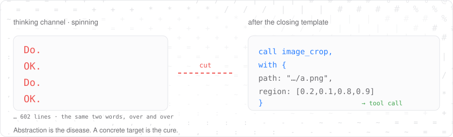
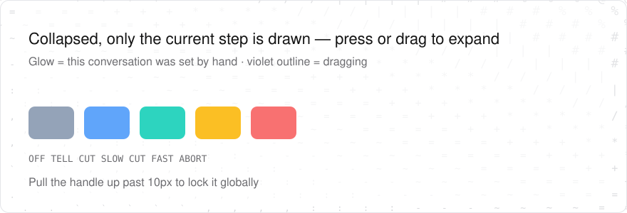
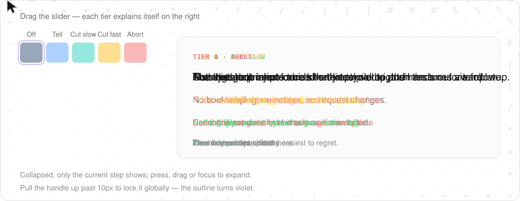

<p align="center">
  
</p>

<p align="center">
  <a href="LICENSE"></a>
  <a href="package.json"></a>
  <a href="package.json"></a>
  
  
</p>

<p align="center">
  <b>The first guard that strips filler lines instead of deleting thoughts</b><br>
  <sub>As of 2026-11-24, every publicly available DSH guard, proxy and paper implementation we could find
  rewrites history by replacing a whole block or throwing away the whole attempt. None of them strips line by line.</sub>
</p>

<p align="center">
  <b>A loop guard for the thinking channel</b> — when a model keeps writing 「做。/好。/嗯。」,
  it removes those lines from its history one by one and <b>leaves every real sentence intact</b>.
  Only a genuine loop gets cut.
</p>

<p align="center">
  Cutting loses the second half of a thought. Replacing a whole block throws the good part away with the bad.<br>
  Measured: 29% of the lines are filler, but only 8% of the characters — strip that 8% and
  <b>92% of the reasoning still reaches the model</b>.
</p>

<p align="center">
  <a href="#-the-symptom">Symptom</a> ·
  <a href="#-background-how-this-came-about">Background</a> ·
  <a href="#-what-it-does">What it does</a> ·
  <a href="#-install">Install</a> ·
  <a href="#-the-five-step-slider">Slider</a> ·
  <a href="#-why-it-works">Why</a> ·
  <a href="#-configuration">Config</a>
</p>

<p align="center">
  <a href="https://github.com/Laurent928/dsh-thinking-guard/stargazers">
    
  </a>
  <br>
  <sub>It saved me a whole afternoon once. If it saves you one too, leave a star — I'll be insufferable about it for days</sub>
</p>

<p align="center"><b>English</b> · <a href="README.md">中文</a></p>

---

<p align="center">
  
</p>

## 😵 The symptom

<p align="center">
  
</p>

The first time I ran into it, I thought it was thinking hard

A drawing session had been sitting on "thinking" for what felt like two minutes. I opened the thinking block to see what it was chewing on, and found this:

```
做。
好。
做。
好。
```

No text. No tool call. Just those two lines, rolling

Scrolling further: a couple thousand lines of it, and at the very end, a **perfectly correct** tool call

So it got the job done. Everything in between was air. I stared at it for a while, unsure whether to call it clever or broken

Later I went back and counted:

| | |
|---|---|
| Worst single block | **602 of 686 lines** were placeholder verbs |
| Vocabulary | `做。` 1180 times, `好。` 1068 times |
| How those blocks ended | **All ten** emitted the correct tool call |

What actually stopped me was this bit, buried in the middle:

> 「我陷入循环了」 — I'm stuck in a loop
> 「这太荒谬了」 — this is absurd
> 「我在浪费 token」 — I'm burning tokens

**It knew. It yelled at itself for about four hundred lines before it snapped out of it**

So "remind it not to loop" cannot work — it was already reminding itself. What it lacked was not awareness. It lacked a concrete thing to grab onto

---

<p align="center">
  
</p>

## 📜 Background: how this came about

It did not start as an idea for a plugin. It started with a ghost

So I worked through the cheap ideas first, and killed them one at a time:

| What I tried | What happened |
|---|---|
| `stop_sequences` | Reached the server fine, **but does not apply to thinking** — the request carried it, the trigram showed up on line 19, and generation ran to line 121 anyway |
| `frequency_penalty` / `presence_penalty` | Documented as deprecated; sending them does nothing |
| `temperature` | No effect in thinking mode |
| `tool_choice: required` | 400 in thinking mode |
| Shrinking `max_tokens` | Truncates honest answers. Rejected, and rightly so |
| A reminder appended to tool results | `tool/result` is a session event append, not a hook. Cannot intercept it |

Only after all that did I land on "count inside the stream and cut it" — and then discovered that cutting ends the turn outright
(a stop with no tool call is a completed turn), which is why one of the tiers has to synthesize a read-only call just to push the turn forward

**The real fix came last**, and it came from reading the DSH discussion (#7270): degenerate thinking gets replayed into every following turn, so the model reads its own garbage and imitates it. That is why the plugin now strips it out of the context before each request

> The community calls this "singing". It is not something you configured wrong — it is a known degeneration of reasoning models under long context and high effort

---

<p align="center">
  
</p>

## 🛠 What it does

Two layers. **The first one is the main road — not on the slider, always on**:

> Before each request, every line that is nothing but 「做。」「好。」「嗯。」 is dropped from the history, and the rest is kept verbatim.
> Measured: the stripped characters are 3.5–8.2% of the block — **92–96% of the reasoning still reaches the model**.

<p align="center">
  
</p>

That layer is what breaks the self-reinforcement loop — the model sees what it wrote, minus the filler, and stops imitating it. Cutting loses the second half of a thought; replacing a whole block throws the good part away with the bad; stripping line by line does neither. Details in [Why it works](#-why-it-works)

**The second layer is the fallback — the five-tier slider**, and it only fires on a real loop (one adjacent pair repeating ≥8 times, filler lines ≥15% of the block):

| Tier | What it does | Price |
|---|---|---|
| 0 Off | Nothing at all | none |
| 1 Notice | Bans the empty verbs in the system prompt and hands over a closing template | a few dozen characters per request |
| **2 Cut slow** (default) | Cuts the generation, then resumes via followup | waits 7–21 s, history stays clean |
| 3 Cut fast | Cuts, then injects a read-only tool call so the turn keeps going | a fake record in history, latency under 1 s |
| 4 Abort | The third loop in a row kills the turn | you get a failed-run message |

Two more guards, also not on the slider:

- **Cooldown** — three cuts inside ten minutes puts that session on a five-minute pass-through, so a working conversation never gets chopped into confetti
- **Compensation** — a cut block hands its last few real lines back to the model in the after-cut message, so it does not have to re-derive them

> [!WARNING]
> **Raising the tier really does change behaviour, and one tier writes a fake record into your session history.**
>
> - **Tier 3 synthesizes a `get_goal` tool call** to push the turn forward. That record is **fake**; it stays in history and the model can see it on the next step. Pick it only if you would rather trade a clean history for not waiting
> - **Tier 4 kills the turn outright.** You will see a failed-run message and that turn's work is gone
> - **Tier 2 writes nothing fake**, but costs 7–21 seconds
> - **Tier 1 never touches a generation** — it only adds a few dozen characters to the system prompt. Stay there if unsure

---

<p align="center">
  
</p>

## 🚀 Install

**One click** (no command line):

1. **Code → Download ZIP**, and unzip it somewhere you will keep — the plugin loads from that folder, so do not delete or move it later
2. **Windows: just double-click `install.cmd`** — it uses the built-in PowerShell, so no Git, no Node.js and no pnpm are needed
3. macOS / Linux: run `bash install.sh` (that path needs Node.js + pnpm)
4. The only thing left after the script finishes: **restart DSH yourself**
5. After the restart you get a five-segment slider at the right of the composer toolbar

The script does exactly four things: back up the profile's `package.json`, add a `link:` dependency, register the package in `dsh.profile.bundles`, and create the `node_modules` junction that `pnpm install` would normally create. **It never touches session data and never restarts your DSH**

If something goes wrong, copy the `package.json.bak` from the backup folder it printed back over the profile, delete `node_modules/dsh-thinking-guard`, and restart

### Manual install (if you know what you are doing)

```bash
# from the profile directory, e.g. ~/.dsh/profiles/desktop
pnpm add link:<absolute path to this folder> -w
```

Then add the package name to `dsh.profile.bundles` in that profile's `package.json`, and **restart DSH yourself**

**Rolling back**: remove the `link:` dependency and the `bundles` entry, restart. The plugin writes nothing of yours — the only file it owns is `$DSH_HOME/thinking-guard.json` (per-conversation tiers), and deleting that is harmless

---

<p align="center">
  
</p>

## 🎚 The five-step slider

<p align="center">
  
</p>

<p align="center">
  
</p>

- **Collapsed**, only the current step is drawn. Press, drag, or focus to expand the whole track
- **Glow** means "this conversation was set by hand", and it is always the tier colour. Inherited values stay quiet
- The outline turns **violet** while you are dragging. Pull **up past 10px** to lock the value globally
- From tier 2 upward, a warning explains what that tier does and what it costs

---

<p align="center">
  
</p>

## 🧠 Why it works

Three things stack up. Any one of them alone is only half a fix

**One — it is trapped by abstraction**

Look at how every degenerate block escapes, and the pattern is identical:

- `（输出 image_crop。）`
- `（写 bash：重试 IPAdapter。）`
- `（我需要简化。调用 read_image。）`

The moment it squeezes out a sentence with a concrete tool name, the thinking ends and the hands move

That is why the prompt does not say "stop looping" — that sentence has the same shape as the disease and just buys two more rounds. What it gets instead is a template it can copy: `调用 <tool name>，参数 <value>`. Give it a road, and you do not have to block it a hundred times

**Two — cutting mid-stream only stops the bleeding**

Ending the generation early looks like a normal stop to the layer above. No error, no retry, just a step with no tool call

It took me a while to understand the consequence: **the turn is simply over**. The model gets no chance to continue, and the user has to speak again. That is why tier 3 exists — synthesizing a read-only call just to push the turn forward

**Three — the real cause sits in the next turn's input**

I only learned this from the DSH discussion: degenerate thinking is replayed into every following turn. The model reads what it just wrote and leans further into it, so the loop compounds

So before each request the plugin rewrites already-degenerate reasoning in the history. Reasoning only — text and tool calls are never touched

That is the one real cut. Everything above it just buys time

### How the stripping works

Before a request goes out, `GenerateOptions.messages` gets scanned and the reasoning blocks in assistant messages are handled in two ways:

- **Strip filler lines (default)** — every line that is nothing but 「做。」「好。」「嗯。」 is deleted; the rest is kept verbatim. Filler lines are what the model imitates, real sentences are what it actually thought
- **Replace a whole block** — when a block is almost entirely filler, it becomes one line: `（上一段思考陷入重复 N 行占位，已省略）`

Reasoning blocks only; text and tool calls are untouched. The session log keeps the original bytes — only this request does not carry them, and they get stripped again next turn if they are still there.

**How the rewrite reaches the wire.** `options` is deep-frozen, so assigning to `options.messages` throws. That is exactly how earlier versions failed silently — the trace log showed zero successes and zero failures, meaning the whole mechanism had never run. The plugin now clones the options object and re-issues the call through `this.streamWithRegistration()`. Cordis binds waterfall listeners to the LlmRuntime instance, so `this` inside the middleware is exactly what is needed. The clone carries `Symbol.for('dsh.thinking-guard.scrubbed')` so it is never sanitized twice and never re-sent in a loop.

- To turn it off: `scrubDegenerateHistory: false`, or flip the runtime switch (see below)
- To go back to whole-block replacement: `scrubMode: 'squash'`

> The token savings are small — 3.5% to 8.2% of characters in the sessions measured. What it buys is elsewhere: the model stops seeing its own filler lines and stops imitating them.

#### Where this differs from the other guards

| Project | How it rewrites history | Granularity | Can the model still see what it thought? |
|---|---|---|---|
| pi-loop-police | `sanitizeThinkingAt()` replaces the whole contaminated block with a marker | whole block | no |
| dsh-guard-repeat-output | `/guard-cleanup` replaces the whole message; the live path discards the attempt and retries | whole block / whole attempt | no |
| **this plugin** | `stripPlaceholderLines()` deletes filler lines only | **line** | **yes — 92–96% kept** |

### Why not just lower the reasoning effort

Lowering effort trades **global depth** for stability: every task thinks a little less, including the ones that genuinely needed the depth

Loops only happen at particular moments — in the same session, the first few dozen turns were spotless. Shaving the thinking everywhere to fix a problem that shows up in bursts is a bad trade

So the plugin leaves you alone by default, and only moves at that moment

---

<p align="center">
  
</p>

## ⚙️ Configuration

Any key can be overridden from the profile patch

#### Detector and intensity

| Key | Default | Meaning |
|---|---|---|
| `level` | `2` | Fallback intensity when a conversation has no slider record (0–4) |
| `maxRun` | `25` | Consecutive marker lines before it counts as a loop (strict rule: contentless imperatives only) |
| `looseRun` | `15` | Loose threshold, used together with `looseUniq` |
| `looseUniq` | `0.4` | Max unique-line ratio under the loose rule, so repeated-but-real content is not flagged |
| `minLines` | `10` | Below this many lines nothing is judged at all |
| `fuseAfter` | `3` | Consecutive hits before aborting the turn (tier 4 only). 0 disables |

#### Remedies

| Key | Default | Meaning |
|---|---|---|
| `promptText` | one Chinese sentence | System-prompt section. Empty means not registered |
| `noticeText` | `''` | Notice text for the next step. Empty means never inject. Supports `{maxRun}` `{lines}` `{ratio}` |
| `stopSequences` | three Chinese trigrams | Sequences attached to the request, at most 16. **Measured to affect the answer body only, not thinking** |
| `stopEnabled` | `true` | Whether to attach `stop` sequences from tier 2 up |
| `scrubDegenerateHistory` | `true` | Rewrite degenerate reasoning in the history before each request (the real fix) |
| `scrubMode` | `strip` | `strip` deletes filler lines and keeps the content; `squash` replaces the whole block |
| `scrubStripMinDropped` | `5` | In strip mode, a block must lose at least this many lines before it is touched |
| `scrubStrategy` | `redispatch` | `redispatch` clones the options and re-issues the call (works around the frozen object); `inplace` assigns directly and throws when frozen |

#### Mid-stream cut

| Key | Default | Meaning |
|---|---|---|
| `streamKillEnabled` | `true` | Master switch. False means detection only, no action |
| `streamKillRun` | `15` | Trailing 1–6 character lines needed to cut. 0 disables |
| `streamKillMinChars` | `150` | Never cut a thought shorter than this. Lowered from 600: the real incident hit 15 short lines at only 235 characters |
| `streamKillRepeatEnabled` | `true` | **Main detector.** Cut when one adjacent line pair repeats `streamKillRepeatMin` times and filler lines are at least `streamKillRepeatRatioMin` of the block |
| `streamKillRepeatMin` | `8` | Repeats of the same adjacent pair before it counts |
| `streamKillRepeatRatioMin` | `0.15` | Filler-line share required at the same time, so quoted tables and code do not trip it |
| `streamKillRepeatMinLines` | `20` | Blocks shorter than this are not judged by repetition |
| `streamKillEnglishEnabled` | `true` | Sentence-level detector for English: English filler lives inside sentences, where a line-level rule is blind |
| `englishDupRatioMin` | `0.30` | Judge degenerate when one sentence makes up this share of all sentences |
| `englishMinSentences` | `12` | Minimum sentence count before the duplicate rule applies |
| `englishGramMin` | `10` | Judge degenerate when the same first four words repeat this many times |
| `englishGramMinSentences` | `20` | Minimum sentence count before the four-word rule applies |
| `streamKillDensityEnabled` | `false` | Density detector (filler lines as a share of **lines**). Off by default: a 「做。」 line is 2 characters, so 26% of lines was only 3% of characters — on live traffic it cut 11 normal thoughts in 21 minutes |
| `cooldownWindowMs` | `600000` | Cooldown window per session |
| `cooldownHits` | `3` | Cuts inside the window before cooling down |
| `cooldownMs` | `300000` | How long the session only passes through |
| `compensateEnabled` | `true` | Feed the last real lines of a cut block back in the after-cut message |
| `compensateMaxLines` | `3` | How many real lines to carry over |
| `compensateMaxChars` | `240` | Character cap for the carried-over text |
| `streamKillDryRun` | `false` | Dry run: log "would have cut" without cutting |
| `afterKillText` | one Chinese sentence | Message handed to the model after a cut. Empty means none |
| `maxKillStreak` | `3` | Stop cutting after this many cuts in a row in one session. 0 disables |
| `streamKillFastContinue` | `true` | At tier 3 and up, use the synthesized continuation. False forces the followup path |
| `fakeToolName` | `get_goal` | Tool name used by the synthesized call. Must be read-only and idempotent |
| `followupFallback` | `true` | Slow path: resume by delivering a message through `agent.followup` |
| `traceEnabled` | `true` | Write middleware checkpoints to `$DSH_HOME/thinking-guard-trace.log` |

#### Runtime switch (no restart)

Some things are worth flipping mid-conversation — most of all, turning the history rewrite off to see the difference for yourself.

```jsonc
// ~/.dsh/thinking-guard-switches.json
{ "scrub": false }   // off;  { "scrub": true } or delete the file = on (config default)
```

The file is read by mtime, so the next request picks it up. No restart. The middleware evaluates `readSwitch('scrub') ?? cfg.scrubDegenerateHistory`, so the config stays the source of truth until you override it.

How to run an honest A/B in one session: leave the history as it is (the plugin never edits it), ask the same heavy question twice, and flip the switch in between. Measured on a real session: rewrite on → 8.1% filler lines; off → 19.2% and the 「做。⏎好。」 pair came back.

### One parameter that fools people

`stopSequences` looks like the obvious cure, but **it only affects the answer body, not thinking** — DeepSeek will not truncate reasoning on it. It is kept because it may still constrain the answer text. Do not count on it for loops

---

## ⚠️ Known unverified

- **The 4th tier has never fired naturally.** The trigger needs three real loops inside one turn, which is rare in practice. It is covered by unit tests, but nobody has seen it in the wild
- **The synthesized continuation has only been exercised through the test hook**, not by a genuinely degenerate rollout
- **`get_goal` may not exist in every preset.** If it is missing the call fails, but the finish reason is already `tool-calls`, so the turn continues anyway — you just get an error entry in history

---

## ✅ Tests

```bash
node --test "tests/*.test.mjs"
```

Before you touch the detectors, replay a real thinking block through them — no plugin install, no model call:

```bash
node scripts/replay-block.mjs block.txt          # human-readable
node scripts/replay-block.mjs block.txt --json   # machine-readable
```

`block.txt` is one verbatim reasoning block. The script reports four things: filler-line share, how many characters the strip keeps, whether the block-level criterion calls it degenerate, and where (if anywhere) the streaming criterion would cut.

**65 cases**, covering: detector maths (strict and loose rules, blank-line skipping), per-tier behaviour, stream-cut thresholds, the adjacent-pair detector, the cooldown window, cut compensation, line-by-line history scrubbing and the re-dispatch path, the synthesized continuation, followup resumption and the no-duplicate-notice rule, the test hook requiring a session id, stop merging and the 16 limit, notice template substitution, abort and streak reset, per-session state isolation and corrupt-file tolerance, slider routes, and the browser-half load protocol

---

<p align="center">
  <sub>You actually read to the end. <a href="https://github.com/Laurent928/dsh-thinking-guard/stargazers">Leave a star</a>,</sub>
  <br>
  <sub>the whale that wrote this will have more nerve next time it crawls out of bed at 3am to fix a bug</sub>
</p>
