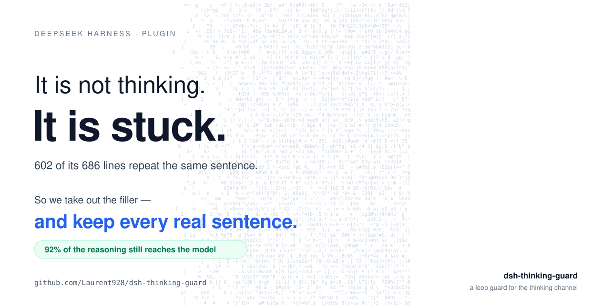

<p align="center">
  
</p>

<p align="center">
  <a href="LICENSE"></a>
  <a href="package.json"></a>
  <a href="package.json"></a>
  
  
</p>

<p align="center">
  <b>The first guard that strips filler lines instead of deleting thoughts</b><br>
  <sub>As of 2026-11-24, every publicly available DSH guard, proxy and paper implementation we could find
  rewrites history by replacing a whole block or throwing away the whole attempt. None of them strips line by line.</sub>
</p>

<p align="center">
  <b>A loop guard for the thinking channel</b> — when a model keeps writing 「做。/好。/嗯。」,
  it removes those lines from its history one by one and <b>leaves every real sentence intact</b>.
  Only a genuine loop gets cut.
</p>

<p align="center">
  Cutting loses the second half of a thought. Replacing a whole block throws the good part away with the bad.<br>
  When a model gets stuck it writes the same sentence over and over — in one real record, 602 of 686 lines were the same line.<br>
  The plugin drops those repeat lines before each request and leaves the rest untouched — <b>in the sessions that actually got stuck, 95–97% of the characters survive</b>.
</p>

<p align="center">
  <b>What 2.0 changes</b>: the focus moved from <b>how to cut the loop</b> to
  <b>how to fix it without cutting at all</b>.<br>
  The harshest tier (fuse: kill the whole turn) is gone, and the default flipped from
  "cut slow" to <b>"clean"</b> — lossless stripping that <b>never interrupts</b>.<br>
  <sub>The tiers also changed shape: one glyph, <b>colour = cleaning on/off, shape = how hard it hits</b> (circle → triangle → square).</sub>
</p>

<p align="center">
  <a href="#-the-symptom">Symptom</a> ·
  <a href="#-background-how-this-came-about">Background</a> ·
  <a href="#-what-it-does">What it does</a> ·
  <a href="#-install">Install</a> ·
  <a href="#-the-glyph">Tiers</a> ·
  <a href="#-why-it-works">Why</a> ·
  <a href="#-what-counts-as-a-loop">Detector</a> ·
  <a href="#-does-the-meaning-survive">Meaning</a> ·
  <a href="#-where-the-numbers-come-from">Data</a> ·
  <a href="#-configuration">Config</a>
</p>

<p align="center">
  <a href="https://github.com/Laurent928/dsh-thinking-guard/stargazers">
    
  </a>
  <br>
  <sub>It saved me a whole afternoon once. If it saves you one too, leave a star — I'll be insufferable about it for days</sub>
</p>

<p align="center"><b>English</b> · <a href="README.md">中文</a></p>

---

<p align="center">
  
</p>

## 😵 The symptom

<p align="center">
  
</p>

The first time I ran into it, I thought it was thinking hard

A drawing session had been sitting on "thinking" for what felt like two minutes. I opened the thinking block to see what it was chewing on, and found this:

```
做。
好。
做。
好。
```

No text. No tool call. Just those two lines, rolling

Scrolling further: a couple thousand lines of it, and at the very end, a **perfectly correct** tool call

So it got the job done. Everything in between was air. I stared at it for a while, unsure whether to call it clever or broken

Later I went back and counted:

| | |
|---|---|
| Worst single block | **602 of 686 lines** were placeholder verbs |
| Vocabulary | `做。` 1180 times, `好。` 1068 times |
| How those blocks ended | **All ten** emitted the correct tool call |

What actually stopped me was this bit, buried in the middle:

> 「我陷入循环了」 — I'm stuck in a loop
> 「这太荒谬了」 — this is absurd
> 「我在浪费 token」 — I'm burning tokens

**It knew. It yelled at itself for about four hundred lines before it snapped out of it**

So "remind it not to loop" cannot work — it was already reminding itself. What it lacked was not awareness. It lacked a concrete thing to grab onto

---

<p align="center">
  
</p>

## 📜 Background: how this came about

It did not start as an idea for a plugin. It started with a ghost

So I worked through the cheap ideas first, and killed them one at a time:

| What I tried | What happened |
|---|---|
| `stop_sequences` | Reached the server fine, **but does not apply to thinking** — the request carried it, the trigram showed up on line 19, and generation ran to line 121 anyway |
| `frequency_penalty` / `presence_penalty` | Documented as deprecated; sending them does nothing |
| `temperature` | No effect in thinking mode |
| `tool_choice: required` | 400 in thinking mode |
| Shrinking `max_tokens` | Truncates honest answers. Rejected, and rightly so |
| A reminder appended to tool results | `tool/result` is a session event append, not a hook. Cannot intercept it |

Only after all that did I land on "count inside the stream and cut it" — and then discovered that cutting ends the turn outright
(a stop with no tool call is a completed turn), which is why one of the tiers has to synthesize a read-only call just to push the turn forward

**The real fix came last**, and it came from reading the DSH discussion (#7270): degenerate thinking gets replayed into every following turn, so the model reads its own garbage and imitates it. That is why the plugin now strips it out of the context before each request

> The community calls this "singing". It is not something you configured wrong — it is a known degeneration of reasoning models under long context and high effort

---

<p align="center">
  
</p>

## 🛠 What it does

Two layers. **The first one is the main road — it runs whenever the colour is on**:

> Before each request, every line that is nothing but 「做。」「好。」「嗯。」 is dropped from the history, and the rest is kept verbatim.
> **In the sessions that actually got stuck, 95–97% of the characters still reach the model**; even the 69 worst blocks keep 66%, where whole-block deletion throws away 98%. Ordinary sessions barely get touched — 0.21% stripped across the whole corpus.

<p align="center">
  
</p>

That layer is what breaks the self-reinforcement loop — the model sees what it wrote, minus the filler, and stops imitating it. Cutting loses the second half of a thought; replacing a whole block throws the good part away with the bad; stripping line by line does neither. Details in [Why it works](#-why-it-works)

**The second layer is the fallback — the two cutting tiers**, and it fires on one of these shapes: the same stretch of tail content repeating verbatim ≥4 times (a 3-character symbol run and a two-thousand-character citation passage both count — language does not matter), or 15 consecutive short lines (1–6 characters) at the tail, or one adjacent pair repeating ≥8 times while filler lines make up ≥15% of the block — once the thought has run past 150 characters. Every rule is spelled out in [What counts as a loop](#-what-counts-as-a-loop):

| Tier | Name | What it does | Price |
|---|---|---|---|
| 0 | Off | No cleaning, no cutting. **The system-prompt section is still registered** (~100 characters; blank out `promptText` to silence that too) | those characters |
| **1** | **Clean** (default) | Lossless stripping plus the system-prompt section, **never interrupts** | slightly larger request, not one character touched |
| 2 | Slow | Tier 1 + cuts a real loop, then resumes via followup | waits 7–21 s, history stays clean |
| 3 | Fast | Tier 1 + cuts, then synthesizes a read-only call so the turn keeps going | a fake record in history, latency under 1 s |

> The fuse tier (the old fifth) is retired — it killed the whole turn, and the cooldown window already stops cascades. `stop_sequences` went the same way. Both still exist in code, but their thresholds now sit where the interface cannot reach.

Two more guards, also not on the glyph:

- **Cooldown** — three cuts inside ten minutes puts that session on a five-minute pass-through, so a working conversation never gets chopped into confetti
- **Compensation** — a cut block hands its last few real lines back to the model in the after-cut message, so it does not have to re-derive them

> [!WARNING]
> **Raising the tier really does change behaviour, and the top tier writes a fake record into your session history.**
>
> - **Tier 3 synthesizes a `get_goal` tool call** to push the turn forward. That record is **fake**; it stays in history and the model can see it on the next step. Pick it only if you would rather trade a clean history for not waiting
> - **Tier 2 writes nothing fake**, but costs 7–21 seconds
> - **Tier 1 never touches a generation** — it only adds a few dozen characters to the system prompt. Stay there if unsure

---

<p align="center">
  
</p>

## 🚀 Install

**One click** (no command line):

1. **Code → Download ZIP**, and unzip it somewhere you will keep — the plugin loads from that folder, so do not delete or move it later
2. **Windows: just double-click `install.cmd`** — it uses the built-in PowerShell, so no Git, no Node.js and no pnpm are needed
3. macOS / Linux: run `bash install.sh` (that path needs Node.js + pnpm)
4. The only thing left after the script finishes: **restart DSH yourself**
5. After the restart you get a single glyph at the right of the composer toolbar — a green circle in the default Clean tier

The script **runs its steps in a deliberate order**: preflight (plugin folder, profile shape, link slot) → back up the original manifest **bytes** → write a temp manifest and parse-check it → create a temp junction and verify it resolves → rename the old link aside → move the new link into place → commit the manifest → cross-check both. Any failure unwinds in reverse order; if the automatic rollback itself fails, it prints the exact paths for manual recovery. **It never touches session data and never restarts your DSH**

If something goes wrong, copy the `package.json.bak` from the backup folder it printed back over the profile, delete `node_modules/dsh-thinking-guard`, and restart. A first-time install and an upgrade over an existing link roll back the same way — the installer prints both paths.

### Manual install (if you know what you are doing)

```bash
# from the profile directory, e.g. ~/.dsh/profiles/desktop
pnpm add link:<absolute path to this folder> -w
```

Then add the package name to `dsh.profile.bundles` in that profile's `package.json`, and **restart DSH yourself**

**Rolling back**: remove the `link:` dependency and the `bundles` entry, restart. The plugin owns two files, both harmless to delete: `$DSH_HOME/thinking-guard.json` (the colour and shape per conversation plus the global default) and `$DSH_HOME/thinking-guard-trace.log` (set `traceEnabled: false` to stop writing it). It never writes to your session logs

---

<p align="center">
  
</p>

## 🎚 The glyph

<p align="center">
  
</p>

<p align="center">
  <sub>Click to toggle cleaning, drag sideways to change tier, <b>drag up 10px to apply everywhere</b>.<b>Colour = cleaning on/off, shape = how hard it hits.</b></sub>
</p>

- **Click**: toggles colour, i.e. toggles history cleaning — green = working, grey = not cleaning
- **Drag sideways**: changes the shape, i.e. the tier (circle → triangle → square), one step per 18px; the three shapes fan out while you drag, and you can just click one
- **Drag down 12px**: slides out the "GATING" panel (it scrolls when there is more in it) holding the adaptive switch. Opposite direction from "up", so they never fight over a gesture
- **Colour covers cleaning, shape covers cutting** — two channels, one job each, readable at a glance
- **Turning the colour off does not turn cutting off**: a grey circle means cleaning off *and* no cutting; a **grey triangle or square means cleaning off but still cutting**. The tooltip says the two things separately ("cleaning off · fast cut on") instead of collapsing them into "no cut"
- Entering either cutting tier (triangle / square) shows a three-second line above the glyph — "this tier really interrupts generation" — and it disappears when you click elsewhere. There is **no confirm dialog**, but the tier does bite; dragging into those tiers with the colour off warns too
- Hover for 600 ms brings up the explanation (moving into the tooltip keeps it open, so the star link is clickable), in your system language
- Keyboard works too: ← → change the cutting tier only, Space / Enter toggles cleaning only

---

<p align="center">
  
</p>

## 🧠 Why it works

Three things stack up. Any one of them alone is only half a fix

**One — it is trapped by abstraction**

Look at how every degenerate block escapes, and the pattern is identical:

- `（输出 image_crop。）`
- `（写 bash：重试 IPAdapter。）`
- `（我需要简化。调用 read_image。）`

The moment it squeezes out a sentence with a concrete tool name, the thinking ends and the hands move

That is why the prompt does not say "stop looping" — that sentence has the same shape as the disease and just buys two more rounds. What it gets instead is a template it can copy: `调用 <tool name>，参数 <value>`. Give it a road, and you do not have to block it a hundred times

**Two — cutting mid-stream only stops the bleeding**

Ending the generation early looks like a normal stop to the layer above. No error, no retry, just a step with no tool call

It took me a while to understand the consequence: **the turn is simply over**. The model gets no chance to continue, and the user has to speak again. That is why tier 3 exists — synthesizing a read-only call just to push the turn forward

**Three — the real cause sits in the next turn's input**

I only learned this from the DSH discussion: degenerate thinking is replayed into every following turn. The model reads what it just wrote and leans further into it, so the loop compounds

So before each request the plugin rewrites already-degenerate reasoning in the history. Reasoning only — text and tool calls are never touched

That is the one real cut. Everything above it just buys time

### How the stripping works

Before a request goes out, `GenerateOptions.messages` gets scanned and the reasoning blocks in assistant messages are handled in two ways:

- **Strip filler lines (default)** — every line that is nothing but 「做。」「好。」「嗯。」 is deleted; the rest is kept verbatim. Filler lines are what the model imitates, real sentences are what it actually thought
- **Replace a whole block** — when a block is almost entirely filler, it becomes one line: `（上一段思考陷入重复 N 行占位，已省略）`

Reasoning blocks only; text and tool calls are untouched. The session log keeps the original bytes — only this request does not carry them, and they get stripped again next turn if they are still there.

**How the rewrite reaches the wire.** `options` is deep-frozen, so assigning to `options.messages` throws. That is exactly how earlier versions failed silently — the trace log showed zero successes and zero failures, meaning the whole mechanism had never run. The plugin now clones the options object and re-issues the call through `this.streamWithRegistration()`. Cordis binds waterfall listeners to the LlmRuntime instance, so `this` inside the middleware is exactly what is needed. The clone carries `Symbol.for('dsh.thinking-guard.scrubbed')` so it is never sanitized twice and never re-sent in a loop.

> **Compatibility note**: re-issuing the call replays the whole `llm/stream` waterfall, so any other middleware on that chain (retry, counters, other rewriting plugins) runs a **second** time. There is no other `llm/stream` middleware on this machine, so nothing broke here. If you run one, check that it is idempotent. Raised by an external review; documented rather than fixed for now.

- To turn it off: `scrubDegenerateHistory: false`, or flip the runtime switch (see below)
- To go back to whole-block replacement: `scrubMode: 'squash'`

> The token savings are small — 3.5% to 8.2% of characters in the sessions measured. What it buys is elsewhere: the model stops seeing its own filler lines and stops imitating them.

#### Where this differs from the other guards

| Project | How it rewrites history | Granularity | Can the model still see what it thought? |
|---|---|---|---|
| pi-loop-police | `sanitizeThinkingAt()` replaces the whole contaminated block with a marker | whole block | no |
| dsh-guard-repeat-output | `/guard-cleanup` replaces the whole message; the live path discards the attempt and retries | whole block / whole attempt | no |
| **this plugin** | `stripPlaceholderLines()` deletes filler lines only | **line** | **yes — 92–96% kept** |

### Why not just lower the reasoning effort

Lowering effort trades **global depth** for stability: every task thinks a little less, including the ones that genuinely needed the depth

Loops only happen at particular moments — in the same session, the first few dozen turns were spotless. Shaving the thinking everywhere to fix a problem that shows up in bursts is a bad trade

So the plugin leaves you alone by default, and only moves at that moment

---

## 🔍 What counts as a loop

Two sets of criteria: one decides whether this turn should be stopped, the other decides whether a finished block is rotten.

**Mid-stream (decides the cut)**:

| Condition | Meaning |
|---|---|
| **exact tail period**: the same content repeating verbatim ≥ `cycleMinRepeats` (4) times, with a periodic stretch ≥ `cycleMinChars` (48) characters, once the thought has run past `streamKillMinChars` | **the other main rule since 2026-11-26**, blind to language, line breaks and punctuation. Protocol closing tags, unseparated symbol runs, repeated Chinese sentences, Russian cycles, multi-K citation loops — all land here |
| or trailing 1–6 character lines ≥ `streamKillRun` (15), with ≥ `streamKillMinChars` (150) characters written | the main rule for Chinese filler rotation — 14 of 26 cuts in two days |
| or English sentence-level: the same sentence (normalised) covering ≥ `englishDupRatioMin` (0.30) of all sentences, with ≥ `englishMinSentences` (12) sentences | English filler lives inside sentences, where a line-level rule is blind |
| or one adjacent line pair repeating ≥ `streamKillRepeatMin` (8) **and** filler lines ≥ `streamKillRepeatRatioMin` (15%) | pitched as the main detector, it has **never fired in two days**. Kept as a supplement |
| blocks under `streamKillRepeatMinLines` (20) lines | adjacent pairs are not counted |

Every rule is counted **per reasoning block**. These counters used to be stream-wide, so "14 short lines + one real `read` + 14 short lines" added up to 28 consecutive short lines: the plugin synthesized a `get_goal` *after* the real tool had already been forwarded, and swallowed the original `stop`. Switching blocks now switches state, and a finished block drops its state.

And **once the stream has produced a real tool call or visible text, no synthetic continuation happens at all** — that turn already has something to run; a fake tool would add a bogus record and lose a real finish event.

> Not hiding the gap: the design called adjacent pairs the main signal; two days of traffic say the trailing-short-line rule is what moves. The real work is done by the history scrub — it forwards **126 times** over the same period, an order of magnitude more than cutting.

**Five shapes were missing until 2026-11-26.** They share exactly one property: the same bytes come around again at the tail.

| Shape | Why the old rules were blind | Period |
|---|---|---|
| protocol closing tags (`</assistant>`) repeating | one line is 12 characters, not a "1–6 character line", and not in the Chinese filler list | 13 |
| unseparated symbol runs (`！！：`) | the whole passage is a single line, so line-start and density rules both fail | 3 |
| the same long Chinese sentence repeating | thirty-odd characters per line — neither short nor filler | 36 |
| Russian / other non-CJK short-sentence cycles | the Chinese filler list does not know them and the English rule does not read Cyrillic | 95 |
| a whole numbered citation passage cycling | period over a thousand characters, longer than any line-level window | 2294 |

The test is a **character-by-character period** over a bounded tail window — no hashing, no similarity score. A wrong period mismatches on its first character, so the average probe costs one or two comparisons: **0.05 ms** on a normal window, **0.31 ms** on a real loop. The window advances by characters received (every 512), not by chunk count, so splitting the same text into 11- or 256-character chunks gives the same verdict — there is a test for exactly that.

**Block-level (used at pre-step, judges a finished block)**:

| Condition | Meaning |
|---|---|
| a run of ≥ `maxRun` (25) filler lines | degenerate, straight away |
| or a run of ≥ `looseRun` (15) with a unique-line ratio ≤ `looseUniq` (0.4) | catches the short-and-dense ones |
| under `minLines` (10) lines | not judged at all |

The two scales differ on purpose: below ten lines a share means nothing, while mid-stream has to win a race, so it is looser.

### The gate: when a cut is allowed at all (2.2.0)

After a detector says "this is a loop", one more question: **is this session in an abnormal phase right now?** On by default; drag the glyph down to turn it off.

The reason is measured (177 sessions / 2,423 turns): a fixed threshold at 20% *or* 30% catches 4/4 incident sessions but **wrecks the same game session every time** — it was cut 11 times. The difference is not the absolute level, it is the rate of change:

```
game session   13.6% → 14.0% → 17.2% → 18.5% → 19.5%  (peaks at 31.4%)
real incident  11.8% → 11.8% → 12.0% → 11.8% → 87.3%
```

Normal sessions climb slowly, and the baseline climbs right along with them, so "median baseline × 2" never catches up. Real incidents jump, and clear it instantly.

| Rule | Incidents caught | Normal sessions hit |
|---|---|---|
| fixed > 20% / > 30% | 4/4 | 1 every time |
| baseline × 3 | 2/4 | 0 |
| **baseline × 2 + floor 20%** | **4/4** | **0** |

Across a 12-point sweep only the 2× band is stable (1.5× always leaks a false fire, 2.5× drops to 3/4, 3× to 2/4), firing on 0.62% of turns.

It only gates **the filler-share detectors** (consecutive short lines / adjacent pairs / density) — those read a *share*, and a gradual climb fools them. English sentence repetition and the exact-period rule demand a verbatim repeat, so they skip the gate. Below a 20% filler ratio the gate stands down too: a `⭐`-style loop has a filler ratio of 0, and gating it would throw away real recall.

With no baseline yet it falls back to the absolute floor of 20% (not "judge nothing"), and **a cut step never enters the history** — otherwise the baseline climbs and the next spike can no longer clear 2×, so one cut would disarm the gate.

**Why "share of short lines" is not the main rule**: it flags real analysis leads like 「可能：」 or 「我该：」 as filler — five false positives in testing. The line-based density rule retired for the same reason before v0.3.0: a 「做。」 line is 2 characters, so 26% of the lines was only 3% of the characters, and on live traffic it cut 11 normal thoughts in 21 minutes.

**How much headroom**: outside the session that blew up (its normal blocks peaked at 20 lines), the other five sessions held 968 normal blocks whose longest filler run was 1–3 lines; genuinely degenerate blocks started at 40. The threshold of 25 sits between them with room on both sides.

**English needs its own detector.** English filler does not fall into one-word lines like 「好。」 — it lives inside sentences: `Let me check it. Let me run the build.` over and over. The line-level rule is blind to it (0 hits across 4,504 pure-English blocks, not because they were clean, because they were invisible). So there is a sentence-level set:

| Condition | Meaning |
|---|---|
| one sentence (normalised) covering ≥ `englishDupRatioMin` (0.30) of all sentences, with ≥ `englishMinSentences` (12) sentences | whole sentences repeating — **the only English condition that can cut** |
| the same first four words repeating ≥ `englishGramMin` (10) times, covering ≥ `englishGramRatioMin` (0.10) of all sentences | **observation only** — written to the trace, never cuts |

**Why the four-word rule was demoted.** It cannot tell two identical-looking things apart: one set of sentences repeating, versus a perfectly normal checklist where all 25 sentences start with `For this verification pass,` and each ends differently. Both score 1.0 on opener frequency. The previous version cut on it, which is how a normal control got cut at 11-character chunks and passed untouched at 256-character chunks. Automatic cutting now rests on "the same sentence repeating" and the mid-stream exact period — both demand a verbatim repeat.

And the metrics run on **prose only**: fenced code, lines with `href=` / `http`, short list items, and bare HTML tag lines **that have a matching opening tag**. Orphan closing tags (`</assistant>`, `</invoke>` — no `<assistant` anywhere before them) are kept as literals: they are not HTML, they are protocol artefacts, and when a model starts repeating them they are the evidence.

That last part was added 2026-11-25. The model was writing a README nav — a dozen `<a href>` lines pointing at in-page anchors — which normalise to the same sentence, so it scored 32% and got cut. **That is authoring a table of contents, not looping.** The original text is now a fixture in `tests/host.test.mjs`, and a rerun over 10,092 English blocks gives **zero false positives**.

Those thresholds come from those 4,504 real English blocks: duplicate-sentence share p99 0.10, max 0.267. At 0.30, **zero false positives** on our corpus. **Recall is unverified** — there is not a single real English loop sample in our data, so only someone who hits one can tell us.

---

## 🎯 Does the meaning survive?

This is the actual selling point, so it has to be checkable — not just a claim that "we keep 92%"

Three premises, each measured

**One: every dropped line carries no information of its own**

All 25,908 dropped lines, checked one by one:

| Check | Result |
|---|---|
| Contains a comma / colon / bracket (i.e. plays a part in a sentence) | **0 lines** |
| Contains a reference — 「这个 / 它 / 该 / 刚才」 (this, it, that, just now) | **0 lines** |
| Distinct spellings | 21, all bare verbs — 「做。」「好。」「嗯。」「写。」「（调用）」「执行。」 |

**Two: what is left is a strict subsequence of the original**

All 3,005 touched blocks compared line by line: every surviving line appears in the original, in the original order, **3,005 / 3,005 pass**; content that does not exist in the original: **0 characters**

So it is a subtraction, nothing else — no rewriting, no stitching, no reordering

**Three: nothing gets cut mid-sentence**

23,807 dropped lines sat in the middle of a block, 2,101 at the end, **0 at the beginning**

Only **4 lines** had an unclosed punctuation mark (a 「，」 or 「：」) in front of them. All four, read:

| Case | Example | Verdict |
|---|---|---|
| A code semicolon | `const ok=…;` ⏎ 「好。」 | False positive — a code line ending, not a sentence break |
| A code semicolon | `slot.timer = setTimeout(…);` ⏎ 「调用。」 | Same, and it is the last line anyway |
| Text already broken | `**我的判断：**` ⏎ 「嗯。」 ⏎ `我的判断：` | The line after it is filler too; nothing is lost |
| Text already broken | `**再软一点**：` ⏎ 「好。」 ⏎ 「写。」 | That line gets dropped as well; there was nothing there to begin with |

Put together: the removed lines carry nothing, what remains is byte-for-byte the original lines, and not one cut lands inside a sentence — **the meaning has no room to change**

### Eight blocks, read by hand

After the machine pass I pulled eight real blocks and read each one, all three versions side by side in [the samples](docs/semantic-samples.md)

| Sample | Original | Stripped | Can you still tell what it decided? | Whole-block replace |
|---|---|---|---|---|
| 1 | 65 lines / 813 chars | 20.2% | Yes — three conclusions, a suggestion, the fix | No |
| 2 | 47 lines / 532 chars | 24.1% | Yes — verification steps 1/2/3 | No |
| 3 | 115 lines / 1233 chars | 30.1% | Yes — style diagnosis plus a controlled experiment | No |
| 4 | 118 lines / 999 chars | 33.5% | Yes — three fixes and the exact line positions | No |
| 5 | 122 lines / 999 chars | 37.9% | Yes — the full safe-zone spec | No |
| 6 | 131 lines / 946 chars | 44.0% | Yes — three directions and where to mine them | No |
| 7 | 69 lines / 455 chars | 49.2% | Yes — which memory to update, how to close out | No |
| 8 | 107 lines / 691 chars | 55.0% | Yes — the new approach and which fields to grab | No |

8 of 8 still say what the block was trying to do. Through whole-block replacement the same eight become one「omitted」line each — unreadable

### One honest limit

What survives is not pure signal

Sample 6 still carries 「嗯，执行。」「嗯，动手。」「嗯，写命令。」 — **half-filler**: they contain a comma and an action verb, so the rule does not classify them and they stay

That is deliberate. Better to strip too little than to delete something real. Those lines were already in the original; they are not among the removed shells, and they do not weaken the claim that the removed part carries no information. Catching them is a job for the sentence-level rule, not the line-level one

Check it yourself:

```bash
node scripts/check-semantic-integrity.mjs            # the three premises, corpus-wide
node scripts/dump-pairs.mjs --n 8 --out pairs.md     # export your own side-by-side samples
```

---

## 📊 Where the numbers come from

None of the percentages above were eyeballed. The corpus is **17,633 reasoning blocks** from 184 sessions on my machine — 461,430 lines, 38 million characters — measured with the plugin's own `stripPlaceholderLines()`, so what gets measured is what actually runs.

| Item | Value (2026-11-25 snapshot) |
|---|---|
| Session files | 184 |
| Reasoning blocks | 17,633 |
| Lines / characters | 469,164 / 38,391,706 |
| Filler lines | 25,908 (5.52% of all lines) |
| Filler characters | 53,585 (0.14% of all characters) |

**Across every block**: 38,391,706 characters untouched, 38,312,307 (99.79%) after stripping — the entire corpus loses about 79k characters.

> **Do not sell that 99.8%.** Its denominator is tens of thousands of blocks that never got stuck, so the number drifts toward 100% as the corpus grows — collect a few more conversations and it becomes 99.9%. What matters is the sessions that actually broke: 95–97% there, and 66% on the worst 69 blocks (whole-block deletion keeps 2%).

**On the 69 blocks the block-level criterion calls degenerate**, the two approaches split hard:

| Approach | Kept | Share of original |
|---|---|---|
| Line-by-line strip (this plugin) | 43,123 characters | **66.49%** |
| Whole-block replace (everybody else) | 1,311 characters | 2.02% |

Same 69 blocks, same 64,854 characters. Whole-block replacement throws nearly all of it away — one「omitted」line per block — while line-by-line strip keeps more than half. **That table is the entire basis for the "information retention" claim.**

One more: of those 69 blocks, **0** end up empty after stripping. Not one was pure filler, so every block kept some real text; only a block that strips down to zero characters falls back to the marker.

**Run it yourself**:

```bash
node scripts/measure-scrub.mjs                     # scans $DSH_HOME/sessions by default
node scripts/measure-scrub.mjs /path/to/sessions   # point it at another corpus
node scripts/measure-scrub.mjs --json              # machine-readable
```

**Limits**: this is a local corpus, not a public dataset — another corpus will give different numbers. It also drifts: it was 17,633 blocks while this page was written, and it is not that number an hour later. Trust the order of magnitude, not the last digit.

---

<p align="center">
  
</p>

## ⚙️ Configuration

Any key can be overridden from the profile patch

#### Detector and intensity

| Key | Default | Meaning |
|---|---|---|
| `level` | `1` | Fallback intensity when a conversation has no stored record (0–3: off / clean / slow / fast) |
| `maxRun` | `25` | Consecutive marker lines before it counts as a loop (strict rule: contentless imperatives only) |
| `looseRun` | `15` | Loose threshold, used together with `looseUniq` |
| `looseUniq` | `0.4` | Max unique-line ratio under the loose rule, so repeated-but-real content is not flagged |
| `minLines` | `10` | Below this many lines nothing is judged at all |
| `fuseAfter` | `3` | **Retired** (the old tier-4 fuse). It needs `level >= 4`, and the interface and state file stop at 3 — only a hand-written `level: 4` in the profile patch wakes it up |

#### Remedies

| Key | Default | Meaning |
|---|---|---|
| `promptText` | one Chinese sentence | System-prompt section. Empty means not registered |
| `noticeText` | `''` | Notice text for the next step. Empty means never inject. Supports `{maxRun}` `{lines}` `{ratio}` |
| `stopSequences` | three Chinese trigrams | **Retired.** Measured to affect the answer body only, never thinking; the attach threshold now sits at `level >= 99`, so nothing reaches it except a hand-written `level: 99` |
| `stopEnabled` | `true` | **Retired**, same story. The master switch for cutting is `streamKillEnabled` |
| `scrubDegenerateHistory` | `true` | Rewrite degenerate reasoning in the history before each request (the real fix) |
| `scrubMode` | `strip` | `strip` deletes filler lines and keeps the content; `squash` replaces the whole block |
| `scrubStripMinDropped` | `5` | In strip mode, a block must lose at least this many lines before it is touched |
| `scrubStrategy` | `redispatch` | `redispatch` clones the options and re-issues the call (works around the frozen object); `inplace` assigns directly and throws when frozen |

#### Mid-stream cut

| Key | Default | Meaning |
|---|---|---|
| `streamKillEnabled` | `true` | Master switch. False means detection only, no action |
| `streamKillRun` | `15` | Trailing 1–6 character lines needed to cut. 0 disables |
| `streamKillMinChars` | `150` | Never cut a thought shorter than this. Lowered from 600: the real incident hit 15 short lines at only 235 characters |
| `streamKillRepeatEnabled` | `true` | Cut when one adjacent line pair repeats `streamKillRepeatMin` times and filler lines are at least `streamKillRepeatRatioMin` of the block |
| `streamKillRepeatMin` | `8` | Repeats of the same adjacent pair before it counts |
| `streamKillRepeatRatioMin` | `0.15` | Filler-line share required at the same time, so quoted tables and code do not trip it |
| `streamKillRepeatMinLines` | `20` | Blocks shorter than this are not judged by repetition |
| `streamKillCycleEnabled` | `true` | **Exact-period detector**: cut when the tail repeats the same content verbatim enough times. Blind to language, line breaks and punctuation — protocol closing tags, symbol runs, repeated Chinese sentences, Russian cycles and multi-K citation loops all land here |
| `cycleMinRepeats` | `4` | Verbatim repeats of the same stretch before it counts |
| `cycleMinChars` | `48` | Minimum periodic stretch, so `---` / `====` separators do not look like a loop |
| `cycleWindow` | `12288` | Tail window in characters. A 2.3K period needs 4 repeats, so the window must exceed 4× the period by a margin |
| `cycleStep` | `512` | Characters between checks (character-driven, so chunk size does not change the verdict) |
| `cycleMaxPeriod` | `4096` | Period cap; anything longer is not treated as a loop |
| `adaptiveEnabled` | `true` | **Gate switch**: after a detector fires, ask "is this session in an abnormal phase?" first. Off = the 2.1.0 behaviour. Also togglable at runtime via `{"adaptive": false}` in `thinking-guard-switches.json` |
| `adaptiveMultiplier` | `2` | This step's filler ratio must exceed "median baseline × this" before cutting is allowed. Only 2× survived a 12-point sweep |
| `adaptiveFloor` | `0.20` | Absolute floor when the baseline is near 0; when the ratio is below it the gate always lets the cut through (how `⭐`-style loops stay caught) |
| `adaptiveMinLines` | `30` | Minimum non-empty lines before a step is judged |
| `adaptiveWarmupSteps` | `3` | Steps before a baseline exists fall back to the absolute floor |
| `adaptiveWindow` | `8` | How many recent steps the baseline median is taken over |
| `adaptiveLockSteps` | `5` | Steps of lock after a cut: the gate keeps passing on the absolute floor instead of waiting for the baseline |
| `streamKillEnglishEnabled` | `true` | Sentence-level detector for English: English filler lives inside sentences, where a line-level rule is blind |
| `englishDupRatioMin` | `0.30` | Judge degenerate when one sentence makes up this share of all sentences |
| `englishMinSentences` | `12` | Minimum sentence count before the duplicate rule applies |
| `englishStep` | `600` | Sampling interval in characters received (not deltas — delta-based sampling made chunk size change the verdict) |
| `englishGramMin` | `10` | **Observation** threshold for the four-word opener. Since 2026-11-26 it never cuts: it cannot tell a repeated set of sentences from a same-shaped checklist |
| `englishGramMinSentences` | `20` | Same, sentence-count floor |
| `englishGramRatioMin` | `0.10` | Same, share-of-sentences floor |
| `streamKillDensityEnabled` | `false` | Density detector (filler lines as a share of **lines**). Off by default: a 「做。」 line is 2 characters, so 26% of lines was only 3% of characters — on live traffic it cut 11 normal thoughts in 21 minutes |
| `cooldownWindowMs` | `600000` | Cooldown window per session |
| `cooldownHits` | `3` | Cuts inside the window before cooling down |
| `cooldownMs` | `300000` | How long the session only passes through |
| `compensateEnabled` | `true` | Feed the last real lines of a cut block back in the after-cut message |
| `compensateMaxLines` | `3` | How many real lines to carry over |
| `compensateMaxChars` | `240` | Character cap for the carried-over text |
| `streamKillDryRun` | `false` | Dry run: log "would have cut" without cutting |
| `afterKillText` | one Chinese sentence | Message handed to the model after a cut. Empty means none |
| `maxKillStreak` | `3` | Stop cutting after this many cuts in a row in one session. 0 disables |
| `streamKillFastContinue` | `true` | At tier 3 and up, use the synthesized continuation. False forces the followup path |
| `fakeToolName` | `get_goal` | Tool name used by the synthesized call. Must be read-only and idempotent |
| `followupFallback` | `true` | Slow path: resume by delivering a message through `agent.followup` |
| `traceEnabled` | `true` | Write middleware checkpoints to `$DSH_HOME/thinking-guard-trace.log` |

#### Runtime switch (no restart)

Some things are worth flipping mid-conversation — most of all, turning the history rewrite off to see the difference for yourself.

```jsonc
// ~/.dsh/thinking-guard-switches.json
{ "scrub": false }   // off;  { "scrub": true } or delete the file = on (config default)
```

The file is read by mtime, so the next request picks it up. No restart. The middleware evaluates `readSwitch('scrub') ?? cfg.scrubDegenerateHistory`, so the config stays the source of truth until you override it.

How to run an honest A/B in one session: leave the history as it is (the plugin never edits it), ask the same heavy question twice, and flip the switch in between. Doing that earlier in one session: with rewriting on the 「做。⏎好。」 pair stopped appearing; with it off the pair came back.

### One parameter that fools people

`stopSequences` looks like the obvious cure, but **it only affects the answer body, not thinking** — DeepSeek will not truncate reasoning on it. It is kept because it may still constrain the answer text. Do not count on it for loops

---

## ⚠️ Known unverified

- **The synthesized continuation has only been exercised through the test hook**, not by a genuinely degenerate rollout. When it does fire, a fake `get_goal` call lands in your history — that is the price, stated up front
- **`get_goal` may not exist in every preset.** If it is missing the call fails, but the finish reason is already `tool-calls`, so the turn continues anyway — you just get an error entry in history
- **Recall rests on the one session that blew up**; precision is zero false positives across 968 normal blocks in five other sessions
- **The English detector's recall is unverified** (precision: zero false positives on 4,504 real English blocks) — there is not a single English loop sample in our corpus
- **The exact-period detector has only been validated on reconstructed corpora, and has not yet won a single new catch on live traffic.** Replayed over 17,795 real thought blocks (38.8M characters) on 2026-11-26, it fired on 68 blocks — **all of them Chinese filler rotation** (periods 4/8/16/20/43) — while all five shapes it was built for (protocol closing tags, symbol runs, long Chinese sentences, Russian, multi-K citation loops) appear **zero times** in our own corpus, and every hit clustered in 4 old incident sessions. The upshot is a narrow false-positive surface, since it demands a verbatim repeat (the one false positive that version produced was "48 consecutive newlines", since fixed); the cost is that **real recall is still unknown** until someone hits one
- **Periods longer than the window are invisible**: 12,288-character window, four repeats minimum, so a cycle with a period above 3,072 characters is not caught (such a turn would usually hit max-tokens long before anyway)
- **`stop_sequences` does not touch thinking — falsified 2026-11-24.** The code path works (`config.stop` → `GenerateOptions.stop` → serialised into `stop_sequences`, visible in the request headers), the server accepted it, and the stream still ran to line 121 after the naked trigram showed up on line 19. That is why the attach threshold now sits at `level >= 99`

---

## ✅ Tests

```bash
node --test "tests/*.test.mjs"
```

Before you touch the detectors, replay a real thinking block through them — no plugin install, no model call:

```bash
node scripts/replay-block.mjs block.txt          # human-readable
node scripts/replay-block.mjs block.txt --json   # machine-readable
```

`block.txt` is one verbatim reasoning block. The script reports four things: filler-line share, how many characters the strip keeps, whether the block-level criterion calls it degenerate, and where (if anywhere) the streaming criterion would cut.

To see how the two approaches diverge across a **whole corpus**, run `scripts/measure-scrub.mjs` — the numbers and the comparison table live in [Where the numbers come from](#-where-the-numbers-come-from).

**92 cases**. Alongside the earlier coverage, `tests/stream-corpus.test.mjs` feeds every degenerate shape and every normal control through 7 / 11 / 64 / 256 / 1024-character chunks and asserts **the verdict does not depend on the chunk size** — the previous version cut one normal control at 11 characters and passed it whole at 256. It also pins block isolation (two independent 14-line blocks must not add up to 28), the followup-failure path (a delivery error must leave the original stream and its `stop` intact, and must not count as a cut), and the CommonMark fence closing rules.

The rest of the suite covers: detector maths (strict and loose rules, blank-line skipping), per-tier behaviour (including tier 1 never shrinking the budget and tier 2 shrinking exactly one step), stream-cut thresholds and early give-up, the adjacent-pair detector, the English sentence detector, the cooldown window, cut compensation, line-by-line history scrubbing and the re-dispatch path, the runtime switch, the synthesized continuation, followup resumption and the no-duplicate-notice rule, the test hook requiring a session id, the retired stop path and its 16-item limit, notice template substitution, per-session state isolation and corrupt-file tolerance, the two-axis colour-plus-shape store, the loopback route, and the browser-half load protocol

---

<p align="center">
  <sub>You actually read to the end. <a href="https://github.com/Laurent928/dsh-thinking-guard/stargazers">Leave a star</a>,</sub>
  <br>
  <sub>the whale that wrote this will have more nerve next time it crawls out of bed at 3am to fix a bug</sub>
</p>
