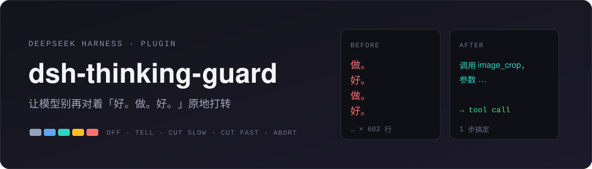
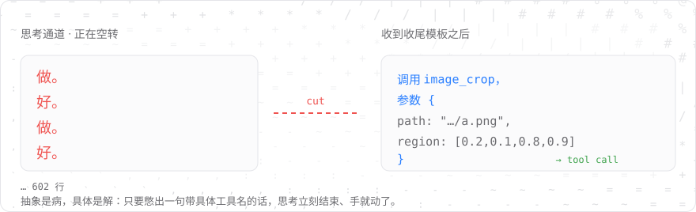
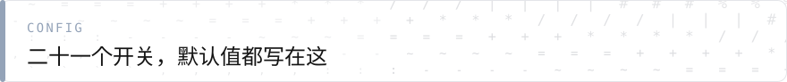

<p align="center">
  
</p>

<p align="center">
  <a href="LICENSE"></a>
  <a href="package.json"></a>
  <a href="package.json"></a>
  
</p>

<p align="center">
  <b>A loop guard for the thinking channel</b> — it catches the moment a model starts
  chanting placeholder verbs while reasoning, and gives it a way out
</p>

<p align="center">
  <a href="#-the-symptom">Symptom</a> ·
  <a href="#-background-how-this-came-about">Background</a> ·
  <a href="#-what-it-does">What it does</a> ·
  <a href="#-install">Install</a> ·
  <a href="#-the-five-step-slider">Slider</a> ·
  <a href="#-why-it-works">Why</a> ·
  <a href="#-configuration">Config</a>
</p>

<p align="center">
  <a href="https://github.com/Laurent928/dsh-thinking-guard/stargazers">
    
  </a>
  <br>
  <sub>It saved me a whole afternoon once. If it saves you one too, leave a star — I'll be insufferable about it for days</sub>
</p>

<p align="center"><b>English</b> · <a href="README.md">中文</a></p>

---

<p align="center">
  
</p>

<p align="center">
  
</p>

## 😵 The symptom

<p align="center">
  
</p>

The first time I ran into it, I thought it was thinking hard

A drawing session had been sitting on "thinking" for what felt like two minutes. I opened the thinking block to see what it was chewing on, and found this:

```
做。
好。
做。
好。
```

No text. No tool call. Just those two lines, rolling

Scrolling further: a couple thousand lines of it, and at the very end, a **perfectly correct** tool call

So it got the job done. Everything in between was air. I stared at it for a while, unsure whether to call it clever or broken

Later I went back and counted:

| | |
|---|---|
| Worst single block | **602 of 686 lines** were placeholder verbs |
| Vocabulary | `做。` 1180 times, `好。` 1068 times |
| How those blocks ended | **All ten** emitted the correct tool call |

What actually stopped me was this bit, buried in the middle:

> 「我陷入循环了」 — I'm stuck in a loop
> 「这太荒谬了」 — this is absurd
> 「我在浪费 token」 — I'm burning tokens

**It knew. It yelled at itself for about four hundred lines before it snapped out of it**

So "remind it not to loop" cannot work — it was already reminding itself. What it lacked was not awareness. It lacked a concrete thing to grab onto

---

<p align="center">
  
</p>

## 📜 Background: how this came about

It did not start as an idea for a plugin. It started with a ghost

So I worked through the cheap ideas first, and killed them one at a time:

| What I tried | What happened |
|---|---|
| `stop_sequences` | Reached the server fine, **but does not apply to thinking** — the request carried it, the trigram showed up on line 19, and generation ran to line 121 anyway |
| `frequency_penalty` / `presence_penalty` | Documented as deprecated; sending them does nothing |
| `temperature` | No effect in thinking mode |
| `tool_choice: required` | 400 in thinking mode |
| Shrinking `max_tokens` | Truncates honest answers. Rejected, and rightly so |
| A reminder appended to tool results | `tool/result` is a session event append, not a hook. Cannot intercept it |

Only after all that did I land on "count inside the stream and cut it" — and then discovered that cutting ends the turn outright
(a stop with no tool call is a completed turn), which is why one of the tiers has to synthesize a read-only call just to push the turn forward

**The real fix came last**, and it came from reading the DSH discussion (#7270): degenerate thinking gets replayed into every following turn, so the model reads its own garbage and imitates it. That is why the plugin now strips it out of the context before each request

> The community calls this "singing". It is not something you configured wrong — it is a known degeneration of reasoning models under long context and high effort

---

<p align="center">
  
</p>

## 🛠 What it does

Five escalating tiers. The further down, the more effective and the more expensive

| Tier | What it does | Price |
|---|---|---|
| 0 Off | Nothing at all | none |
| **1 Tell** (default) | The system prompt forbids the empty verbs and hands out a closing template | a few dozen characters per request |
| 2 Cut slow | Cuts the generation, then resumes via followup | waits 7–21 s, history stays clean |
| 3 Cut fast | Cuts, then injects a read-only tool call so the turn keeps going | a fake record in history, latency under 1 s |
| 4 Abort | The third loop in a row kills the turn | you get a failed-run message |

> [!WARNING]
> **Raising the tier really does change behaviour, and one tier writes a fake record into your session history.**
>
> - **Tier 3 synthesizes a `get_goal` tool call** to push the turn forward. That record is **fake**; it stays in history and the model can see it on the next step. Pick it only if you would rather trade a clean history for not waiting
> - **Tier 4 kills the turn outright.** You will see a failed-run message and that turn's work is gone
> - **Tier 2 writes nothing fake**, but costs 7–21 seconds
> - The default, **tier 1, does not touch the request at all** — it only adds a few dozen characters to the system prompt. Stay there if unsure

There is also one step that is **not on the slider** and always on: before a request goes out, already-degenerate reasoning is stripped from the context (see [Why it works](#-why-it-works))

---

<p align="center">
  
</p>

## 🚀 Install

**One click** (no command line):

1. **Code → Download ZIP**, and unzip it somewhere you will keep — the plugin loads from that folder, so do not delete or move it later
2. Windows: double-click `install.cmd`. macOS / Linux: run `bash install.sh`
3. The script finds your DSH, backs up the profile, and hooks the plugin in. It prints two steps at the end — run `pnpm install` in the profile it names, then **restart DSH yourself**
4. After the restart you get a five-segment slider at the right of the composer toolbar, sitting on Tell

The script does exactly three things: back up the profile's `package.json`, add a `link:` dependency, and register the package in `dsh.profile.bundles`. **It never touches session data and never restarts your DSH**

If something goes wrong, copy the `package.json.bak` from the backup folder it printed back over the profile, then run `pnpm install` again

### Manual install (if you know what you are doing)

```bash
# from the profile directory, e.g. ~/.dsh/profiles/desktop
pnpm add link:<absolute path to this folder> -w
```

Then add the package name to `dsh.profile.bundles` in that profile's `package.json`, and **restart DSH yourself**

**Rolling back**: remove the `link:` dependency and the `bundles` entry, restart. The plugin writes nothing of yours — the only file it owns is `$DSH_HOME/thinking-guard.json` (per-conversation tiers), and deleting that is harmless

---

<p align="center">
  
</p>

## 🎚 The five-step slider

<p align="center">
  
</p>

<p align="center">
  
</p>

- **Collapsed**, only the current step is drawn. Press, drag, or focus to expand the whole track
- **Glow** means "this conversation was set by hand", and it is always the tier colour. Inherited values stay quiet
- The outline turns **violet** while you are dragging. Pull **up past 10px** to lock the value globally
- From tier 2 upward, a warning explains what that tier does and what it costs

---

<p align="center">
  
</p>

## 🧠 Why it works

Three things stack up. Any one of them alone is only half a fix

**One — it is trapped by abstraction**

Look at how every degenerate block escapes, and the pattern is identical:

- `（输出 image_crop。）`
- `（写 bash：重试 IPAdapter。）`
- `（我需要简化。调用 read_image。）`

The moment it squeezes out a sentence with a concrete tool name, the thinking ends and the hands move

That is why the prompt does not say "stop looping" — that sentence has the same shape as the disease and just buys two more rounds. What it gets instead is a template it can copy: `调用 <tool name>，参数 <value>`. Give it a road, and you do not have to block it a hundred times

**Two — cutting mid-stream only stops the bleeding**

Ending the generation early looks like a normal stop to the layer above. No error, no retry, just a step with no tool call

It took me a while to understand the consequence: **the turn is simply over**. The model gets no chance to continue, and the user has to speak again. That is why tier 3 exists — synthesizing a read-only call just to push the turn forward

**Three — the real cause sits in the next turn's input**

I only learned this from the DSH discussion: degenerate thinking is replayed into every following turn. The model reads what it just wrote and leans further into it, so the loop compounds

So before each request the plugin replaces already-degenerate reasoning blocks with a short note. Reasoning only — text and tool calls are never touched

That is the one real cut. Everything above it just buys time

### How the stripping works

Before a request goes out, `GenerateOptions.messages` gets scanned, and any **degenerate reasoning block** in an assistant message is replaced with:

```
（上一段思考陷入重复 N 行，已省略）
```

- Reasoning blocks only. Text and tool calls are untouched
- Same detector as below — no separate rulebook
- The session log keeps the original. This request simply does not carry it; if it degenerates again next turn, it gets stripped again
- To turn it off: `scrubDegenerateHistory: false`

### Why not just lower the reasoning effort

Lowering effort trades **global depth** for stability: every task thinks a little less, including the ones that genuinely needed the depth

Loops only happen at particular moments — in the same session, the first few dozen turns were spotless. Shaving the thinking everywhere to fix a problem that shows up in bursts is a bad trade

So the plugin leaves you alone by default, and only moves at that moment

---

<p align="center">
  
</p>

## ⚙️ Configuration

Any key can be overridden from the profile patch

#### Detector and intensity

| Key | Default | Meaning |
|---|---|---|
| `level` | `2` | Fallback intensity when a conversation has no slider record (0–4) |
| `maxRun` | `25` | Consecutive marker lines before it counts as a loop (strict rule: contentless imperatives only) |
| `looseRun` | `15` | Loose threshold, used together with `looseUniq` |
| `looseUniq` | `0.4` | Max unique-line ratio under the loose rule, so repeated-but-real content is not flagged |
| `minLines` | `10` | Below this many lines nothing is judged at all |
| `fuseAfter` | `3` | Consecutive hits before aborting the turn (tier 4 only). 0 disables |

#### Remedies

| Key | Default | Meaning |
|---|---|---|
| `promptText` | one Chinese sentence | System-prompt section. Empty means not registered |
| `noticeText` | `''` | Notice text for the next step. Empty means never inject. Supports `{maxRun}` `{lines}` `{ratio}` |
| `stopSequences` | three Chinese trigrams | Sequences attached to the request, at most 16. **Measured to affect the answer body only, not thinking** |
| `stopEnabled` | `true` | Whether to attach `stop` sequences from tier 2 up |
| `scrubDegenerateHistory` | `true` | Strip degenerate reasoning out of the context before each request |

#### Mid-stream cut

| Key | Default | Meaning |
|---|---|---|
| `streamKillEnabled` | `true` | Master switch. False means detection only, no action |
| `streamKillRun` | `15` | Trailing 1–6 character lines needed to cut. 0 disables |
| `streamKillMinChars` | `1000` | Never cut a thought shorter than this — protects short steps |
| `streamKillDryRun` | `false` | Dry run: log "would have cut" without cutting |
| `afterKillText` | one Chinese sentence | Message handed to the model after a cut. Empty means none |
| `maxKillStreak` | `3` | Stop cutting after this many cuts in a row in one session. 0 disables |
| `streamKillFastContinue` | `true` | At tier 3 and up, use the synthesized continuation. False forces the followup path |
| `fakeToolName` | `get_goal` | Tool name used by the synthesized call. Must be read-only and idempotent |
| `followupFallback` | `true` | Slow path: resume by delivering a message through `agent.followup` |
| `traceEnabled` | `true` | Write middleware checkpoints to `$DSH_HOME/thinking-guard-trace.log` |

### One parameter that fools people

`stopSequences` looks like the obvious cure, but **it only affects the answer body, not thinking** — DeepSeek will not truncate reasoning on it. It is kept because it may still constrain the answer text. Do not count on it for loops

---

## ⚠️ Known unverified

- **The 4th tier has never fired naturally.** The trigger needs three real loops inside one turn, which is rare in practice. It is covered by unit tests, but nobody has seen it in the wild
- **The synthesized continuation has only been exercised through the test hook**, not by a genuinely degenerate rollout
- **`get_goal` may not exist in every preset.** If it is missing the call fails, but the finish reason is already `tool-calls`, so the turn continues anyway — you just get an error entry in history

---

## ✅ Tests

```bash
node --test "tests/*.test.mjs"
```

54 cases, covering: detector maths (strict and loose rules, blank-line skipping), per-tier behaviour, stream-cut thresholds, the synthesized continuation (`finish` must be `tool-calls` and a tool-call block must exist), followup resumption and the no-duplicate-notice rule, the test hook requiring a session id, stop merging and the 16 limit, notice template substitution, abort and streak reset, per-session state isolation and corrupt-file tolerance, slider routes (GET/POST/403/400/405), the browser-half load protocol and render path, colour-ramp ordering and tier count

---

<p align="center">
  <sub>You actually read to the end. <a href="https://github.com/Laurent928/dsh-thinking-guard/stargazers">Leave a star</a>,</sub>
  <br>
  <sub>the whale that wrote this will have more nerve next time it crawls out of bed at 3am to fix a bug</sub>
</p>
