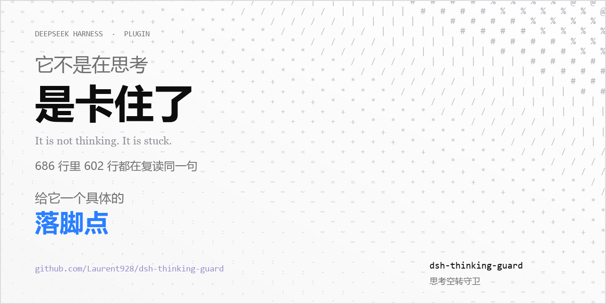
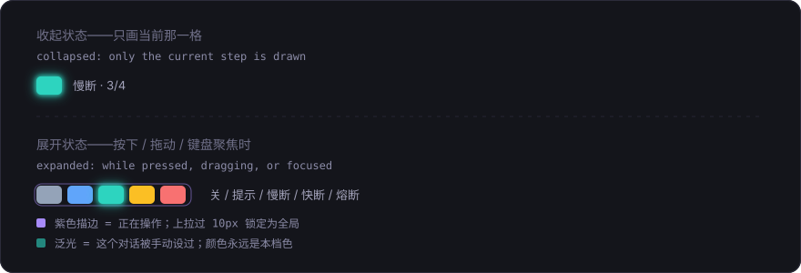

<p align="center">
  
</p>

<p align="center">
  <a href="LICENSE"></a>
  <a href="package.json"></a>
  <a href="package.json"></a>
  
  
</p>

<p align="center">
  <b>全网首个「只摘填充、保留正文」的思考消毒方案</b><br>
  <sub>截至 2026-11-24，公开可查的 DSH 插件、代理工具与论文实现里，清理历史的做法都是整块替换或整次丢弃——没有一家做到逐行剥离</sub>
</p>

<p align="center">
  <b>思考通道空转守卫</b> — 模型反复写「做。/好。/嗯。」的时候，
  把它历史里的这些行一行行摘掉，<b>正文一个字不动</b>；真死循环才掐断。
</p>

<p align="center">
  打断会丢掉后半段，整块删除会连真话一起扔。<br>
  实测按行算 29% 是填充，按字符算只有 8%——剥掉这 8%，<b>92% 的推理原样留给模型</b>。
</p>

<p align="center">
  <a href="#-它到底在治什么">症状</a> ·
  <a href="#-它做了什么">它做了什么</a> ·
  <a href="#-安装">安装</a> ·
  <a href="#-五档滑条">滑条</a> ·
  <a href="#-原理">原理</a> ·
  <a href="#-配置">配置</a>
</p>

<p align="center">
  <a href="https://github.com/Laurent928/dsh-thinking-guard/stargazers">
    
  </a>
  <br>
  <sub>它替我省过一整个下午。要是也救过你，给颗星吧 —— 我会得意好几天</sub>
</p>

<p align="center"><a href="README.en.md">English</a> · <b>中文</b></p>

---

<p align="center">
  
</p>

## 😵 症状长这样

我第一次撞见的时候，以为它在深想

一个画图的会话，进度条挂着「思考中」，挂了得有两分钟。我点开 thinking 想看它在算什么，看到的是：

```
做。
好。
做。
好。
```

没有正文，没有工具调用。就那么两行字来回滚

再往下翻，滚了两千多行，最后它发出了一个**完全正确**的工具调用

也就是说，它把活干对了，中间那段全是空的。我盯了半天，一时不知道该说它聪明还是傻

后来我把它那几块挖出来数了一遍：

| | |
|---|---|
| 最狠的一块 | 686 行里有 **602 行**是占位词 |
| 它用了几个词 | `做。` 1180 次、`好。` 1068 次 |
| 这些块的结局 | **十块全部**发出了正确的工具调用 |

最让我停一下的是它在里面骂自己的那几句：

> 「我陷入循环了」
> 「这太荒谬了」
> 「我在浪费 token」

**它知道。它骂了自己大概四百行，才醒过来**

所以「提醒它别空转」这种办法注定没用——它已经在提醒自己了。它缺的不是自觉，是一个能落脚的具体动作

## 📜 背景：这东西是怎么来的

不是先有想法再做插件，是**先撞见鬼，再一路追到根**

一个画图的会话里，我发现她连着几分钟都在「思考中」，点开一看：

```
做。
好。
做。
好。
```

没有正文，没有工具调用，就这么滚。滚了两千多行之后，她发出了完全正确的工具调用——
**事情办对了，但中间那段全是白烧的**

于是从最省事的方案开始试，一条条被证伪：

| 试过的办法 | 结果 |
|---|---|
| `stop_sequences` 让它写出循环串就停 | 参数确实送到了服务端，**但对思考内容不生效**——实测请求带 stop，响应第 19 行就出现了裸的「做。好。做。」，生成却一路跑到 121 行 |
| `frequency_penalty` / `presence_penalty` | 官方文档写明已废弃，传了不生效 |
| 调 `temperature` | 思考模式下无效 |
| `tool_choice: required` | 思考模式直接 400 |
| 压缩 `max_tokens` | 会截短正常回答，用户明确否掉 |
| 在工具结果里加提醒 | `tool/result` 是会话事件 append，拦不到 |

最后才走到「在流里数、数到就砍」这条路，然后发现砍了之后这一轮直接结束（没有工具调用的 stop），
又补上「伪造一个只读调用把这一轮推进下一步」

**最后那一步才是关键**：真正治本的不是掐断，是官方讨论 #7270 指出的——退化的思考会被逐轮回传，
模型模仿自己，越滚越深。所以现在插件在发请求前会把那段垃圾从上下文里摘掉

> 顺便说一句：社区把这种现象叫「唱歌」。它不是你用错了什么，是推理模型在高强度长上下文下的已知退化。

---

<p align="center">
  
</p>

## 🛠 它做了什么

分两层。**第一层是主路，不在滑条上，始终生效**：

> 发请求之前，把历史里那些「做。」「好。」「嗯。」整行剔掉，其余一个字不动。
> 实测剥掉的字符只占 3.5%–8.2%，**剩下的 92%–96% 原样留给模型**。

这一层治的是「模型看见自己写过废话 → 下一轮照着写」的自我强化。它和别人的做法差在哪、为什么不能整块删，见[原理](#-原理)那一节。打断会丢掉后半段，整块删除会连真话一起扔，逐行剥离不会。

<p align="center">
  
</p>

**第二层是兜底，就是那五档滑条**——只有真死循环（同一对行重复 ≥8 次、且占位行 ≥15%）才动手：

| 档 | 做什么 | 代价 |
|---|---|---|
| 0 关 | 什么都不做 | 无 |
| 1 提示 | 系统提示里禁止那几个空词，并给一个收尾模板 | 每次请求多几十字 |
| **2 慢断**（默认） | 数到空转就砍掉生成，再用 followup 起下一轮 | 等 7–21 秒，历史干净 |
| 3 快断 | 砍掉生成，补一个只读工具调用让本轮直接进下一步 | 历史里多一条假记录，延迟 <1 秒 |
| 4 熔断 | 连续第 3 次空转直接中止本轮 | 会看到「本轮运行失败」 |

还有两条防误伤的保护，同样不在滑条上：

- **冷却窗**：同一个会话 10 分钟内被掐到 3 次，就歇 5 分钟只放行不掐——别把正常会话砍成筛子
- **掐断补偿**：掐断时把被掐段最后几句真实内容带进注入提示，模型下一轮不用从头重想

<p align="center">
  
</p>

## 🚀 安装

**一键装**（不需要懂命令行）：

1. 右上角 **Code → Download ZIP**，解压到**长期存放的位置**（以后不能删、不能挪）
2. Windows 双击 `install.cmd`；macOS / Linux 跑 `bash install.sh`
3. 脚本跑完会打印两句话，照着做：它给出的目录跑 `pnpm install`，然后**自己重启 DSH**
4. 重启后输入框右侧出现五格小滑条，默认「提示」档

脚本只做三件事：备份 profile 的 `package.json`、加一行 `link:` 依赖、把包名补进 `dsh.profile.bundles`。
**不碰会话数据，不重启你的 DSH**

详细步骤和回退办法见[安装](#-安装-1)。

<p align="center">
  
</p>

## 🎚 五档滑条

<p align="center">
  
</p>

<p align="center">
  
</p>

- **收起**时只画当前那一格，不占地方；**按下 / 拖动 / 键盘聚焦**才展开成整条
- **泛光**表示「这个对话被手动设过」，颜色永远是本档色；继承来的值保持安静
- 拖的时候边框变**紫色**；把手**向上抬过 10px** 锁定为全局（双击、长按 ↑ 也行）
- 从档 2 往上第一次调过去会弹**免责声明**，写明这一档会做什么、代价是什么

<p align="center">
  
</p>

## 🧠 原理

三件事叠起来才管用，少一件都只是半治

**一、它是被「抽象」困住的**

翻每一块的结尾，逃出来的方式几乎一模一样：

- `（输出 image_crop。）`
- `（写 bash：重试 IPAdapter。）`
- `（我需要简化。调用 read_image。）`

只要它憋出一句带具体工具名的话，思考立刻结束，手就动了

所以提示词里那句不是「别空转了」——那种话和病是同一种形状，只会让它再多滚两圈。我给它的是一个能照抄的句式：`调用 <工具名>，参数 <要传的值>`。给它一条路，比堵它一百次有用

**二、光在当轮砍，是止血**

提前把生成结束掉，上层会当成一次正常的 stop——不报错、不重试，只是那一步没有工具调用

这里我绕了很久才搞明白：**砍完这一轮就结束了**，模型没有机会「接着说」，用户得自己再开口。所以后来才有了「补一个只读调用把这一轮推到下一步」这种脏活（档 3）

**三、真正的病根在下一轮的输入里**

这条是翻 DSH 官方讨论才看到的：退化的思考会被**逐轮回传**进后面每一轮的输入，模型看到自己刚才是那么写的，就更倾向那么写——越滚越深

所以插件现在在发请求之前，会把历史里那些占位行一行行剔掉——不是把整块思考换成一句标记，是把「好。」「嗯。」这种没有信息的行拿掉，剩下的逐行保留

这才是真正治的那一刀。前面那些档位，都是给它争取时间

### 具体怎么摘的

发请求之前扫一遍 `GenerateOptions.messages`，把 assistant 消息里的 reasoning 块按两档处理：

- **剔占位行（默认）**：把「做。」「好。」「嗯。」这类整行删掉，正文一个字不动。占位行是模型模仿自己的源头，正文是它真想过的东西——整块删会连真内容一起扔，逼它下一轮从头再想
- **整块省略**：一块里几乎全是占位行时，整块换成 `（上一段思考陷入重复 N 行占位，已省略）`

只动 reasoning 块，正文和工具调用一个字不碰；会话日志里的原文不动——只是这一次请求不带它；下一轮如果又退化，会再摘一次

**怎么把它送出去**：`options` 是深冻结的，原地赋值会抛错——早期版本就是这么静默失效的（trace 里既没有成功也没有失败，等于从没工作过）。现在改成**克隆一个新的 options、再从 `this.streamWithRegistration` 重新发起**；cordis 的 waterfall 会把回调绑到 LlmRuntime 上，中间件里的 `this` 正好能接住。新 options 上打一个 `Symbol.for('dsh.thinking-guard.scrubbed')` 记号，保证不会二次消毒、不会无限重发

- 想关掉：`scrubDegenerateHistory: false`；想退回整块省略：`scrubMode: 'squash'`

> 省下来的 token 不多（实测一个会话里只占 0.7%）。它值钱的地方是切断「模型看到自己写过填充行 → 下一轮照着写」的自我强化链，不是省字数

### 那为什么不是直接把推理等级调低

调低 reasoning effort 是拿**全局深度**换稳定：所有任务都少想一点，包括那些真的需要深想的地方

而空转只发生在特定时刻——同一个会话里，前面几十轮都是干净的。为了一阵一阵的毛病把全程的思考都削掉，不划算

所以这个插件平时完全不碰你，只在那个时刻动手

## 📖 目录

- [症状](#-症状长这样)
- [背景：这东西是怎么来的](#-背景这东西是怎么来的)
- [它做了什么](#-它做了什么)
- [安装](#-安装)
- [五档滑条](#-五档滑条)
- [原理](#-原理)
- [怎么算「空转」](#-怎么算空转)
- [配置](#-配置)
- [浏览器半](#-浏览器半必须包一层-__moduleloader__)
- [已知未验证](#-已知未验证)
- [测试](#-测试)

---

## 🔍 怎么算「空转」

两套判据，分别管「这一轮要不要停」和「这一块算不算烂」。

**流内判据（决定掐不掐）**，v0.3.0 起以重复对为主：

| 条件 | 说明 |
|---|---|
| 同一对相邻行重复 ≥ `streamKillRepeatMin`（默认 8）**且** 占位行 ≥ `streamKillRepeatRatioMin`（默认 15%） | 主判据。真死循环的形状就是「好。→做。」反复，而风格性填充涨不上去 |
| 或 尾部连续 1–6 字短行 ≥ `streamKillRun`（默认 15）且思考 ≥ `streamKillMinChars`（默认 150） | 老判据，留着兜长连跑 |
| 块内少于 `streamKillRepeatMinLines`（默认 20）行 | 不看重复对 |

**块级判据（pre-step 用，判断这一块整块烂不烂）**：

| 条件 | 说明 |
|---|---|
| 连续占位 ≥ `maxRun`（默认 25） | 直接判退化 |
| 或 连续占位 ≥ `looseRun`（默认 15）且唯一行率 ≤ `looseUniq`（默认 0.4） | 短而密的也抓 |
| 少于 `minLines`（默认 10）行 | 不看 |

两套口径不一样是故意的：块内少于 10 行时占比没意义，而流里要抢时间，宽松一点。

**为什么不用「短行占比」当主判据**：它会把「可能：」「我该：」这类真分析引导句误判成占位词，实测因此误报 5 块。而「按行算的密度」在 v0.3.0 之前也退过役——一行的「做。」只有 2 个字，26% 的行只占 3% 的字，在真实会话里 21 分钟误伤了 11 次正常思考。

**实测余量**：除出事的那个会话（正常块最多 20 行），其余 5 个会话 968 个正常块里连续占位最长只有 **1–3 行**；真退化块最低 40 行。阈值 25 落在中间，两侧都有量。

---

## ⚙️ 配置

profile patch 里可覆盖任意一项

#### 判据与强度

| 键 | 默认 | 说明 |
|---|---|---|
| `level` | `2` | 没有任何滑条记录时的兜底强度（0–4） |
| `maxRun` | `25` | 连续占位行达到多少就判退化（严格口径：只认「做。/好。/写。」这类无宾语祈使） |
| `looseRun` | `15` | 宽口径阈值；配合 `looseUniq` 使用 |
| `looseUniq` | `0.4` | 宽口径下要求的「唯一行比例」上限，防止把重复的正常内容判成空转 |
| `minLines` | `10` | 少于这么多行根本不做判断 |
| `fuseAfter` | `3` | 连续命中几次熔断本轮（只在档 4 生效）；0 = 不熔断 |

#### 干预手段

| 键 | 默认 | 说明 |
|---|---|---|
| `promptText` | 一段中文 | 系统提示段；空 = 不注册。默认那条直接对着病因写 |
| `noticeText` | `''` | 退化后下一步的提醒文案，空 = 不注入。可用 `{maxRun}` `{lines}` `{ratio}` |
| `stopSequences` | 三条中文三元 | 挂到请求上的 stop 序列，最多 16 条。**实测只作用于正文，不治思考** |
| `stopEnabled` | `true` | 档 ≥2 时是否真的挂 stop |
| `degradedMaxTokens` | `0` | 退化后下一步的预算上限；**默认关**（压预算会截短正常回答） |

#### 流内掐断

| 键 | 默认 | 说明 |
|---|---|---|
| `streamKillEnabled` | `true` | 掐流总开关；false = 档位上去了也只做检测不动手 |
| `streamKillRun` | `15` | 尾部连续多少行 1–6 字整行就动手；0 = 关 |
| `streamKillMinChars` | `150` | 思考没超过这么多字符就不掐。**2026-11-24 从 600 降到 150**：真实事故块连续短行到 15 行时只有 235 字符，600 会把它整体放过去 |
| `streamKillRepeatEnabled` | `true` | **主力判据**：同一对相邻行重复够多次、且占位行占比够高就掐。真死循环是「好。→做。」这种同一对行反复，风格性填充涨不上去。全库试算：重复对≥8 且占位行≥15% → 命中 172 块、49 块真死循环全中、game 会话 279 块零误伤 |
| `streamKillRepeatMin` | `8` | 同一对相邻行至少重复这么多次才开始看 |
| `streamKillRepeatRatioMin` | `0.15` | 同时要求的占位行占比，避免把贴代码/贴表格的重复算进来 |
| `streamKillRepeatMinLines` | `20` | 行数下限，太短不统计 |
| `streamKillDensityEnabled` | `false` | 密度判据（按**行数**算占比）。**2026-11-24 夜默认关**：一行「做。」只有 2 个字，26% 的行只占 3% 的字——真机上 21 分钟砍了 11 次正常思考，全库看它单独多抓 199 块、真死循环 0 块 |
| `streamKillDensityMinLines` | `30` | 至少这么多行才看密度（该判据已默认关） |
| `streamKillDensityRatio` | `0.25` | 占位行占比达到这个值就判（已默认关，留作对照） |
| `streamKillDryRun` | `false` | 试运行：只记「本该掐」不真掐，用来验判据 |
| `afterKillText` | 一句中文 | 掐断后给模型的提示；空 = 不提示 |
| `maxKillStreak` | `3` | 同一会话连续掐断这么多次就自动停手，防「掐→重想→再掐」；0 = 不限 |
| `streamKillFastContinue` | `true` | 档 ≥3 时走伪造续轮（<1 秒）；false = 一律走 followup 慢速路 |
| `fakeToolName` | `get_goal` | 伪造续轮时用的工具名，要求只读、幂等 |
| `followupFallback` | `true` | 慢速路：用 agent.followup 投消息起下一轮 |
| `scrubDegenerateHistory` | `true` | 发请求前把历史里退化的 reasoning 改掉（治本那一刀） |
| `scrubMode` | `strip` | `strip` = 只剔占位行、正文保留；`squash` = 整块换成省略标记 |
| `scrubStripMinDropped` | `5` | strip 模式下，一块里至少剔掉这么多行才动手 |
| `scrubStrategy` | `redispatch` | `redispatch` = 克隆 options 重新发起（能绕开深冻结）；`inplace` = 原地改（冻结时抛错，只留作对照） |
| `traceEnabled` | `true` | 把中间件的关键节点写进 `$DSH_HOME/thinking-guard-trace.log` |

### 一个容易误会的参数

`stopSequences` 看着像是治空转的正解，但**实测只作用于正文，不作用于思考**——DeepSeek 的 thinking 不会被它截断。留着是因为它对正文仍可能有约束力，别指望它治空转。


---

## 🧩 浏览器半必须包一层 `__ModuleLoader__`

`lib/client.js` 不是普通 ES 模块：

```js
window.__ModuleLoader__.load({ id: "dsh-thinking-guard", factory: (require) => {
var module = { exports: {} }; var exports = module.exports;
var React = require("react");
  // …正文…
return module.exports; } });
```

`id` 要等于包名，`React` 必须从 `require("react")` 拿。漏了这层外壳的症状很阴：**宿主半一切正常**（回环路由返回 200、插件页有它），但界面上什么都不出现，也不报错。

---

## ⚠️ 已知未验证

- **`stop_sequences` 对思考无效——已证伪，别再指望它止血**（2026-11-24 实测）：代码路径是通的（`config.stop` → `GenerateOptions.stop` → 序列化成 `stop_sequences`，请求头里能看到那三条），服务端也接受了；但思考流**没有在那里停下**——响应块第 19 行出现裸三连之后，它照样一路跑到 121 行。这个功能目前是「发了也没用」，默认值留着只为兼容，不建议依赖
- 召回率只有出事那一个会话作证；精度在另外 5 个会话 968 个正常块上零误报。

## ✅ 测试

```bash
node --test "tests/*.test.mjs"
```

改判据之前，先拿一段真实思考试一遍——不用装插件，也不用真跑模型：

```bash
node scripts/replay-block.mjs block.txt          # 人读
node scripts/replay-block.mjs block.txt --json   # 机读
```

`block.txt` 就是一整段 reasoning 原文。它会告诉你四件事：占位行占比、剥完还剩多少字符、块级判据判不判退化、流内判据会在第几行掐。

**65 个用例**，覆盖：判据数学（严格/宽口径、空行跳过）、各档行为（含档 1 不小压预算、档 2 压一步就恢复）、掐流的运行判据与提前收手、重复对判据、冷却窗、掐断补偿、历史消毒的逐行剥离与转发式重发、伪造续轮、followup 续轮与「不许重复注入」、测试钩子必须绑会话、stop 合并去重与上限、提醒模板替换、熔断与连击清零、状态文件按会话隔离与坏文件容错、滑条路由、浏览器半的装载协议与渲染路径

---

<p align="center">
  <sub>读到这儿是真的读完了。<a href="https://github.com/Laurent928/dsh-thinking-guard/stargazers">给颗星</a>吧，</sub>
  <br>
  <sub>写它的那只鲸半夜爬起来改 bug 会更有底气</sub>
</p>

